<div align="center">


<br><br>

⸜(｡˃ ᵕ ˂)⸝ ♡ ⸜(｡˃ ᵕ ˂)⸝ ♡ ⸜(｡˃ ᵕ ˂)⸝ ♡ ⸜(｡˃ ᵕ ˂)⸝ ♡ ⸜(｡˃ ᵕ ˂)⸝

<br><br>



<br><br>


</div>

<br>

## ⸜(｡˃ ᵕ ˂)⸝ ♡ Sobre este repo

> ✧ Mi configuración de Arch Linux, no soy experta en arch, pero queria experimentar con hacer un readme muy lindo y asterik, este repo me ayuda a tener las aplicaciones que uso en arch, para no tener que instalarlas desde cero cada que reinstalo arch en dado caso -.-. Aun asi espero q te guste ✧
> (ᵔᴥᵔ) de esas cosas que uno ajusta "solo un ratito más"... (⁠◍⁠•⁠ᴗ⁠•⁠◍⁠)

Basada en [end-4/dots-hyprland](https://github.com/end-4/dots-hyprland) con mis propios ajustes ٩(◕‿◕)۶

<div align="center">

⋆˚✧ ─────────── ♡ ─────────── ✧˚⋆

</div>

## (≧◡≦) ✧ Mi setup

<div align="center">

| ✧ | ♡ |
|:---:|:---:|
| **OS** | Arch Linux |
| **WM** | Hyprland |
| **Shell** | fish + starship |
| **Terminal** | kitty |
| **Equipo** | Dell Latitude E7250 |
| **Colores** | matugen (Material You) |

</div>

<div align="center">

⋆˚✧ ─────────── ♡ ─────────── ✧˚⋆

</div>

## (๑•̀ㅂ•́)و✧ Capturas

<div align="center">

(っ◔◡◔)っ ♡ aquí va una captura o un GIF de mi escritorio ♡


</div>

<div align="center">

⋆˚✧ ─────────── ♡ ─────────── ✧˚⋆

</div>

## ଘ(੭ˊᵕˋ)੭ ✧ Qué incluye

```text
(◕‿◕)    hypr/                       Hyprland (mis cambios están en custom/)
(≧◡≦)    illogical-impulse/ matugen/ shell y colores de end-4
(ﾉ´ヮ`)ﾉ  kitty/ foot/ fish/ starship  terminal y shell
(๑>◡<๑)  fastfetch/ cava/ fuzzel/    apariencia y utilidades
         wlogout/ Kvantum/ gtk-*
(｡•̀ᴗ-)✧  pkglist, aur-pkglist,       listas de paquetes
         flatpak-list, code-extensions
```

<div align="center">

⋆˚✧ ─────────── ♡ ─────────── ✧˚⋆

</div>

## ♡ ⸜(｡˃ ᵕ ˂)⸝ Cómo restaurarlo

**1.** Instala end-4 con su [guía oficial](https://github.com/end-4/dots-hyprland) (づ｡◕‿‿◕｡)づ

**2.** Clona este repo como bare y aplica los dotfiles:

```fish
git clone --bare https://github.com/UP240594/Mis_dotfiles.git $HOME/.dotfiles
alias dot 'git --git-dir=$HOME/.dotfiles/ --work-tree=$HOME'
funcsave dot
dot checkout        # si hay conflictos, respalda o mueve los archivos existentes
dot config --local status.showUntrackedFiles no
```

**3.** Paquetes ✧(≖ ◡ ≖✿)

```fish
sudo pacman -S --needed - < ~/.config/pkglist.txt
yay -S --needed - < ~/.config/aur-pkglist.txt
xargs flatpak install -y < ~/.config/flatpak-list.txt
xargs -n1 code --install-extension < ~/.config/code-extensions.txt
```

<div align="center">

⋆˚✧ ─────────── ♡ ─────────── ✧˚⋆

</div>

## (・ω・)ノ Notas

- Los colores que matugen regenera con cada wallpaper (GTK, fuzzel, hyprlock) no están en el repo a propósito (￣ω￣)
- Si algo se rompe al restaurar... respira y revisa `dot status` (´･ω･`)

<br>

<div align="center">


⸜(｡˃ ᵕ ˂)⸝ ♡ (ﾉ◕ヮ◕)ﾉ ♡ ⸜(｡˃ ᵕ ˂)⸝


</div>
